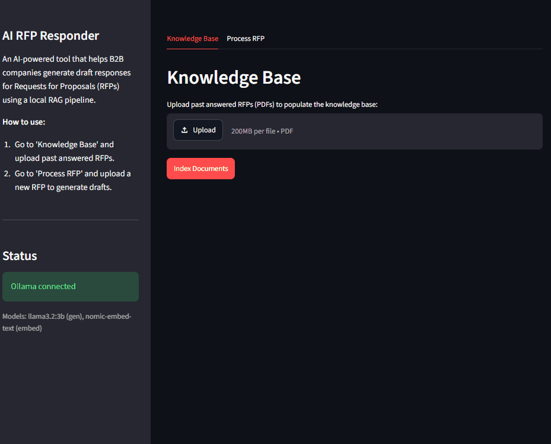

# AI RFP Responder

An AI-powered tool that helps B2B companies generate draft responses for Requests for Proposals (RFPs) using a local RAG (Retrieval-Augmented Generation) pipeline.

Companies spend hundreds of hours answering repetitive questions in RFPs. This tool ingests past answered RFPs into a vector database and uses a local LLM to draft answers for new RFPs, significantly reducing response time.

> **Note:** This is a functional MVP designed to demonstrate the core RAG architecture for RFP automation. For production use, enterprise-grade solutions like Loopio or Responsive offer advanced features, but this project shows how to build the underlying pipeline from scratch using local LLMs.

## Features

- **Knowledge Base:** Upload past answered RFPs (PDFs) to build a local vector database (ChromaDB).
- **Process RFP:** Upload a new RFP to extract questions, retrieve relevant past answers, and generate draft responses.
- **100% Local:** Runs entirely on your machine using Ollama. No API keys or cloud dependencies required.
- **Human-in-the-loop:** All generated drafts are editable before exporting.

## Tech Stack

- Python 3.10+
- Streamlit (UI)
- ChromaDB (Vector Store)
- Ollama (Local LLM: `llama3.2:3b` and `nomic-embed-text`)
- pypdf (PDF parsing)

## How to Run Locally

1. **Install Ollama** and pull the required models:
   ```bash
   ollama pull llama3.2:3b
   ollama pull nomic-embed-text
   ```

2. **Clone the repository** and navigate to the project directory.

3. **Create a virtual environment** and activate it:
   ```bash
   python -m venv venv
   source venv/Scripts/activate  # On Windows
   source venv/bin/activate      # On macOS/Linux
   ```

4. **Install dependencies:**
   ```bash
   pip install -r requirements.txt
   ```

5. **Generate test PDFs:**
   ```bash
   python generate_test_pdfs.py
   ```

6. **Run the application:**
   ```bash
   streamlit run app.py
   ```

7. **Use the UI:**
   - Go to the **Knowledge Base** tab and upload `old_rfp.pdf`. Click "Index Documents".
   - Go to the **Process RFP** tab and upload `new_rfp.pdf`. Click "Generate Drafts".

## Demo



*The GIF demonstrates indexing a past RFP and generating draft answers for a new one using local Ollama models.*

### Example

**Input (old_rfp.pdf - knowledge base):**
- Q: How do you ensure data security? A: We use AES-256 encryption at rest and TLS 1.3 in transit.

**Input (new_rfp.pdf - new question):**
- Q: What security protocols do you use to protect client data?

**Output (generated draft):**
- We use AES-256 encryption at rest and TLS 1.3 in transit, with all employees undergoing annual security training.

## License

This project is licensed under the MIT License.

---
*Developed by Elena Kurbatova*
